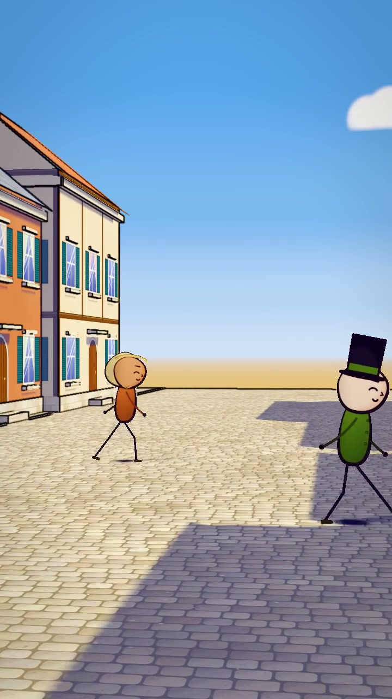

# muse-animated-shorts

**با میوز شورت انیمیشنی وایرال ۵۵ تا ۷۰ ثانیه‌ای بساز — کاراکترهای کارتونی دوبعدی با سر لوبیایی توی یه دنیای سه‌بعدی نقاشی‌شده، با three.js داخل Remotion و رندر محلی. بدون API تولید ویدیو. بدون سرویس پولی. بدون اشتراک.**

خواندن به زبان‌های دیگر: [English](README.md) · [中文](README.zh-CN.md) · [Русский](README.ru.md)



*نمونه‌ی کامل: «سیل آبجوی لندن»، لندن، ۱۷ اکتبر ۱۸۱۴ — یه خمره‌ی ۷ متری آبجو می‌ترکه و یه خیابون رو زیر آب می‌بره. ۶۴٫۵ ثانیه، ۷۲۰×۱۲۸۰، روایت فارسی. تماشا: [`examples/beer-flood/beer-short-final.mp4`](examples/beer-flood/beer-short-final.mp4)*

## این چیه

یه اسکیل برای [میوز](https://muse.ai) که یه داستان واقعی رو تبدیل می‌کنه به یه شورت انیمیشنی عمودی، به سبک کاراکترهای کارتونی دوبعدی که توی یه دنیای سه‌بعدی رنگی و نقاشی‌شده زندگی می‌کنن: کاراکترهای سرلوبیایی با خط‌های جوهری، آسمون اشباع‌شده، پس‌زمینه‌ی محو، دوربین‌های سرخورنده، یه راوی ثابت، و موزیک مارش با افکت‌های صوتی سنتزشده.

همه‌چی روی کامپیوتر خودت ساخته می‌شه:

| بخش | روش | هزینه |
|---|---|---|
| تصویر | three.js داخل Remotion، رندر محلی | ۰ |
| صدا | Piper TTS (آفلاین) یا هر TTS محلی | ۰ |
| زمان‌بندی کلمات | faster-whisper (محلی، روی CPU) | ۰ |
| موزیک و افکت صوتی | سنتزشده با پایتون (numpy/scipy) | ۰ |
| API تولید ویدیو | استفاده نمی‌شه. لازم هم نیست. | ۰ |

بدون کردیت Flow، بدون تولید ویدیوی میوز، بدون رندر ابری، بدون API key، بدون اکانت. اگه جایی یه مرحله کلید می‌خواد، این اسکیل جایگزین محلیش رو می‌گه.

## نصب با یه پرامپت

این رو توی میوز خودت پیست کن:

> Install the muse-animated-shorts skill from https://github.com/rezabz/muse-animated-shorts: clone the repo, copy skill/muse-animated-shorts/SKILL.md to ~/.claude/skills/muse-animated-shorts/SKILL.md, then use it to make me a 55–70 second vertical cartoon story short — 2D bean-head characters in a painted 3D world, three.js inside Remotion, local TTS voice, synthesized music and SFX, no paid API. Start by asking me for the story topic.

یا دستی نصب کن:

```bash
git clone https://github.com/rezabz/muse-animated-shorts.git
mkdir -p ~/.claude/skills/muse-animated-shorts
cp muse-animated-shorts/skill/muse-animated-shorts/SKILL.md ~/.claude/skills/muse-animated-shorts/SKILL.md
```

## شروع سریع

```bash
# ۱. نمونه‌ی کامل رو به‌عنوان نقطه‌ی شروع کپی کن
cp -r muse-animated-shorts/examples/beer-flood/remotion my-short
cd my-short && npm install

# ۲. سناریو رو بنویس (حقایق + فرمول ۸ مرحله‌ای) — توی اسکیل هست
# ۳. صدا رو بساز (Piper) و زمان‌بندی کلمات رو بگیر (faster-whisper)
# ۴. برای داستان خودت story.ts و world.ts و چیدمان کاراکترها رو بازنویسی کن
# ۵. چند ثانیه پیش‌نمایش بگیر، فریم‌ها رو چک کن، بعد رندر کامل:
npx remotion render BeerShort --image-format=jpeg --jpeg-quality=85 --scale=1.0

# ۶. میکس صدا رو بچسبون (با examples/beer-flood/audio/mix.py ساخته می‌شه)
ffmpeg -i silent.mp4 -i audio/mix.wav -c:v copy -c:a aac -shortest final.mp4
```

کتابچه‌ی کامل: [`skill/muse-animated-shorts/SKILL.md`](skill/muse-animated-shorts/SKILL.md)

## یه شورت چطور ساخته می‌شه

۱. **موضوع + حقایق** — یه داستان واقعی غافلگیرکننده با علت و معلول فیزیکی، به‌علاوه یه تشبیه روزمره که مکانیزمش رو توضیح بده. اول منابع.
۲. **سناریو** — ۸ مرحله: هوک → صحنه → تشدید → انفجار → دو خط خشک → توضیح → پیامد → پیچ پایانی. ۵۵ تا ۷۰ ثانیه، صدا از فریم اول شروع می‌شه.
۳. **صدا** — TTS محلی، زمان‌بندی کلمات با STT محلی. همه‌چی به `words.json` وصله.
۴. **پلان شات** — `story.ts`: شات‌ها، دوربین‌ها، کراس‌فید، ضربه‌ها، عمق میدان. فیزیک داستان به‌صورت تابع خالص از زمان.
۵. **دنیا + کاراکتر** — شهر سه‌بعدی نقاشی‌شده، نور خورشید دوتونه، کارت‌های سرلوبیایی با ۱۴ حالت چهره.
۶. **صدا** — مارش اورجینال + افکت‌های سنتزشده، میکس موزیک +۳ دسی‌بل / افکت −۶ دسی‌بل / صدا بدون تغییر، مستر −۱۴ LUFS.
۷. **رندر + کنترل کیفیت** — رندر محلی، چسبوندن صدا، اسکن فریم‌های سیاه و یخ‌زده، چک بلندی صدا، دیدن تصاویر.

## نمونه‌ی کامل

[`examples/beer-flood/`](examples/beer-flood/) ساخت کامل «سیل آبجوی لندن»ـه — نه دمو، خود کار واقعی:

- `remotion/` — پروژه‌ی کامل Remotion (کامپوزیشن `BeerShort`، ۷۲۰×۱۲۸۰، ۳۰ فریم، ۱۹۳۵ فریم)
- `SCRIPT.md` — حقایق تاییدشده + سناریوی فارسی ۱۰ مرحله‌ای (۱۶۱ کلمه)
- `voice/` — روایت فارسی (`voice.wav`، ۶۴٫۴ ثانیه، Piper با صدای `fa_IR-amir-medium`) + `words.json` + فایل‌های هر خط
- `audio/` — `timeline.py`، `music.py`، `sfx.py`، `sfx_gen.py`، `instruments.py`، `dsp.py`، `mix.py`، میکس نهایی `mix.wav` (−۱۴٫۰ LUFS، TP −۱٫۲ dBTP) و استم‌ها
- `beer-short-final.mp4` — شورت نهایی ۶۴٫۵ ثانیه‌ای، ۲۱ مگابایت
- `poster.jpg` — فریم پوستر

زمان رندر روی ماشین بدون GPU: حدود ۳ ثانیه برای هر فریم (حدود ۱۰۰ دقیقه برای ۶۴ ثانیه). با GPU خیلی سریع‌تره.

## محدودیت‌های صادقانه

- **سرعت رندر.** رندر نرم‌افزاری کنده (حدود ۳ ثانیه برای هر فریم در ۷۲۰p). راه‌حل GPU یا پیش‌نمایش با مقیاس کمتره — نه API پولی.
- **ویدیوی واقعی با هوش مصنوعی نیست.** کاراکترها مثل بازیگر واقعی حرکت نمی‌کنن؛ حرکت یعنی سر خوردن دوربین، زوم، چرخه‌ی راه رفتن و عوض شدن حالت چهره. همین سبکه، و جذابیتش همینه.
- **سطح صاف از روبه‌رو دیوار دیده می‌شه.** اسکیل این رو مستند کرده و راه فرارش رو گفته.
- **صداهای TTS محلی فرق می‌کنن.** بعضی‌ها حدود ۲٫۵ کلمه در ثانیه حرف می‌زنن نه ۳٫۷ — صدای خودت رو اندازه بگیر و سناریو رو به‌اندازه‌ش کوتاه کن.
- **دو فریم اول.** اولین حرکت کامپوزر می‌تونه خالی رندر بشه؛ راه‌حلش توی اسکیل هست (کپی فریم ۲) و توی نمونه هم اعمال شده.

## ساختار

```
muse-animated-shorts/
├── README.md / README.fa.md / README.zh-CN.md / README.ru.md
├── LICENSE (MIT)
├── skill/muse-animated-shorts/SKILL.md   <- کتابچه‌ی راهنما
└── examples/beer-flood/                  <- نمونه‌ی کامل، آماده‌ی رندر
    ├── remotion/                         <- پروژه‌ی Remotion
    ├── audio/                            <- سنتز صدا + میکس
    ├── voice/                            <- روایت + زمان‌بندی کلمات
    ├── SCRIPT.md
    ├── beer-short-final.mp4
    └── poster.jpg
```

## اعتبار

- رویکرد سبک اقتباس‌شده از [mromidev/claude-animated-shorts](https://github.com/mromidev/claude-animated-shorts) با لایسنس MIT. داستان، کاراکترها، شات‌ها، موزیک و صدای نمونه کاملا مال خودمونه.
- ساخته‌شده با [Remotion](https://www.remotion.dev/)، [three.js](https://threejs.org/)، [Piper](https://github.com/rhasspy/piper)، [faster-whisper](https://github.com/SYSTRAN/faster-whisper).
- ساخته‌شده با میوز توسط [Reza BZ](https://github.com/rezabz).

## لایسنس

MIT — ببین [LICENSE](LICENSE). استفاده کن، ریمیکس کن، شورت‌های خودت رو بساز.
