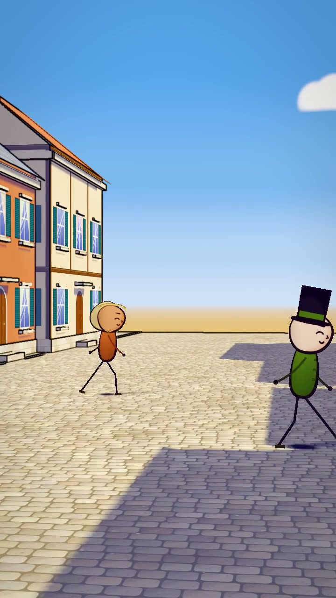

# muse-animated-shorts

**Make viral 55–70 second cartoon story shorts with Muse — 2D bean-head characters in a painted 3D world, rendered locally with three.js inside Remotion. No video-generation API. No paid service. No subscription.**

Read this in: [فارسی](README.fa.md) · [中文](README.zh-CN.md) · [Русский](README.ru.md)



*The worked example: "The London Beer Flood", London, 17 October 1814 — a 22-foot vat of porter bursts and floods a street. 64.5 s, 720×1280, Persian narration. Watch it: [`examples/beer-flood/beer-short-final.mp4`](examples/beer-flood/beer-short-final.mp4)*

## What this is

A skill for [Muse](https://muse.ai) that turns a true story into a vertical animated short in the style of 2D cartoon characters living inside a colourful painted 3D world: flat bean-head characters with ink outlines, a saturated sky, depth-of-field backgrounds, gliding cameras, one steady narrator, and march-style music with synthesized sound effects.

Everything is made on your own machine:

| Piece | How | Cost |
|---|---|---|
| Picture | three.js inside Remotion, local render | $0 |
| Voice | Piper TTS (offline) or any local TTS | $0 |
| Word timings | faster-whisper (local, CPU) | $0 |
| Music + SFX | Synthesized in Python (numpy/scipy) | $0 |
| Video generation API | Not used. Not needed. | $0 |

No Flow credits, no Muse video generation, no cloud render, no API key, no account. If a step needs a key, this skill tells you the local replacement instead.

## One-prompt install

Paste this into your Muse:

> Install the muse-animated-shorts skill from https://github.com/rezabz/muse-animated-shorts: clone the repo, copy skill/muse-animated-shorts/SKILL.md to ~/.claude/skills/muse-animated-shorts/SKILL.md, then use it to make me a 55–70 second vertical cartoon story short — 2D bean-head characters in a painted 3D world, three.js inside Remotion, local TTS voice, synthesized music and SFX, no paid API. Start by asking me for the story topic.

Or install it by hand:

```bash
git clone https://github.com/rezabz/muse-animated-shorts.git
mkdir -p ~/.claude/skills/muse-animated-shorts
cp muse-animated-shorts/skill/muse-animated-shorts/SKILL.md ~/.claude/skills/muse-animated-shorts/SKILL.md
```

## Quickstart

```bash
# 1. Copy the worked example as your starting point
cp -r muse-animated-shorts/examples/beer-flood/remotion my-short
cd my-short && npm install

# 2. Write your script (facts + 8-beat formula) — see the skill
# 3. Generate the voice (Piper) and word timings (faster-whisper)
# 4. Rewrite story.ts / world.ts / cast staging for your story
# 5. Preview a few seconds, check the stills, then render:
npx remotion render BeerShort --image-format=jpeg --jpeg-quality=85 --scale=1.0

# 6. Mux the mix (made by examples/beer-flood/audio/mix.py)
ffmpeg -i silent.mp4 -i audio/mix.wav -c:v copy -c:a aac -shortest final.mp4
```

Full playbook: [`skill/muse-animated-shorts/SKILL.md`](skill/muse-animated-shorts/SKILL.md)

## How a short is built

1. **Topic + facts** — one surprising true story with a physical cause and effect, plus an everyday analogy that explains it. Sources first.
2. **Script** — 8 beats: hook → setting → escalation → snap → deadpan double line → explanation → consequence → callback twist. ~55–70 s, voice starts at frame 1.
3. **Voice** — local TTS, word timings from local STT. Everything is timed to `words.json`.
4. **Shot plan** — `story.ts`: shots, cameras, crossfades, impact kicks, depth of field. Physics as pure functions of story time.
5. **World + characters** — painted 3D town, two-tone sun light, bean-head cards with a 14-expression face library.
6. **Sound** — original march + synthesized SFX, mixed music +3 dB / SFX −6 dB / voice unchanged, mastered to −14 LUFS.
7. **Render + QA** — local render, mux, scan for black/frozen frames, check loudness, look at the pictures.

## The worked example

[`examples/beer-flood/`](examples/beer-flood/) is the complete build of "The London Beer Flood" — not a demo, the real thing:

- `remotion/` — the full Remotion project (`BeerShort` composition, 720×1280, 30 fps, 1935 frames)
- `SCRIPT.md` — verified facts + the 10-beat Persian script (161 words)
- `voice/` — Persian narration (`voice.wav`, 64.4 s, Piper `fa_IR-amir-medium`) + `words.json` + per-line wavs
- `audio/` — `timeline.py`, `music.py`, `sfx.py`, `sfx_gen.py`, `instruments.py`, `dsp.py`, `mix.py`, the final `mix.wav` (−14.0 LUFS, TP −1.2 dBTP) and stems
- `beer-short-final.mp4` — the finished 64.5 s short, 21 MB
- `poster.jpg` — poster frame

Render time on a CPU-only machine: ~3 s/frame (~100 min for 64 s). Much faster on a GPU.

## Honest limits

- **Render speed.** Software rendering is slow (~3 s/frame at 720p). A GPU, or a lower preview scale, is the answer — not a paid API.
- **No real video AI.** Characters never move like filmed actors; motion is glides, push-ins, walk cycles and expression swaps. That is the style, and its charm.
- **A flat surface filmed head-on reads as a wall.** The skill documents this and how to avoid it.
- **Local TTS voices vary.** Some run ~2.5 words/s instead of ~3.7 — measure yours and trim the script to fit.
- **First two frames.** The composer's first advance can render blank; the skill's post-fix (duplicate frame 2) is already applied in the example.

## Structure

```
muse-animated-shorts/
├── README.md / README.fa.md / README.zh-CN.md / README.ru.md
├── LICENSE (MIT)
├── skill/muse-animated-shorts/SKILL.md   <- the playbook
└── examples/beer-flood/                  <- worked example, ready to render
    ├── remotion/                         <- Remotion project
    ├── audio/                            <- sound synthesis + mix
    ├── voice/                            <- narration + word timings
    ├── SCRIPT.md
    ├── beer-short-final.mp4
    └── poster.jpg
```

## Credits

- Style approach adapted from [mromidev/claude-animated-shorts](https://github.com/mromidev/claude-animated-shorts) (MIT). The story, characters, shots, music and voice in the example are entirely our own.
- Built with [Remotion](https://www.remotion.dev/), [three.js](https://threejs.org/), [Piper](https://github.com/rhasspy/piper), [faster-whisper](https://github.com/SYSTRAN/faster-whisper).
- Made with Muse by [Reza BZ](https://github.com/rezabz).

## License

MIT — see [LICENSE](LICENSE). Use it, remix it, make your own shorts.
