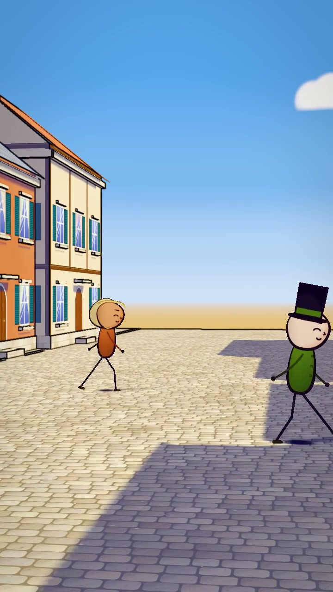

# muse-animated-shorts

**Делайте вирусные мульт-рассказы по 55–70 секунд с Muse — плоские персонажи с бобовидными головами в нарисованном цветном 3D-мире, рендер локально на three.js внутри Remotion. Без API генерации видео. Без платных сервисов. Без подписки.**

Читать на других языках: [English](README.md) · [فارسی](README.fa.md) · [中文](README.zh-CN.md)



*Рабочий пример: «Лондонское пивное наводнение», Лондон, 17 октября 1814 года — 7-метровая бочка с портером взрывается и затапливает улицу. 64,5 с, 720×1280, рассказ на персидском. Смотреть: [`examples/beer-flood/beer-short-final.mp4`](examples/beer-flood/beer-short-final.mp4)*

## Что это

Навык для [Muse](https://muse.ai), который превращает правдивую историю в вертикальный мультфильм в стиле «двумерные персонажи живут в красочном нарисованном 3D-мире»: плоские персонажи с бобовидными головами и чернильными контурами, насыщенное небо, фон с глубиной резкости, скользящие камеры, один спокойный рассказчик и маршевая музыка с синтезированными звуками.

Всё делается на вашем компьютере:

| Часть | Как | Цена |
|---|---|---|
| Картинка | three.js внутри Remotion, локальный рендер | $0 |
| Голос | Piper TTS (офлайн) или любой локальный TTS | $0 |
| Тайминги слов | faster-whisper (локально, на CPU) | $0 |
| Музыка + звуки | Синтез на Python (numpy/scipy) | $0 |
| API генерации видео | Не используется. И не нужно. | $0 |

Без кредитов Flow, без генерации видео в Muse, без облачного рендера, без API-ключа, без аккаунта. Если какой-то шаг требует ключ, навык подскажет локальную замену.

## Установка одной командой

Вставьте это в свой Muse:

> Install the muse-animated-shorts skill from https://github.com/rezabz/muse-animated-shorts: clone the repo, copy skill/muse-animated-shorts/SKILL.md to ~/.claude/skills/muse-animated-shorts/SKILL.md, then use it to make me a 55–70 second vertical cartoon story short — 2D bean-head characters in a painted 3D world, three.js inside Remotion, local TTS voice, synthesized music and SFX, no paid API. Start by asking me for the story topic.

Или установите вручную:

```bash
git clone https://github.com/rezabz/muse-animated-shorts.git
mkdir -p ~/.claude/skills/muse-animated-shorts
cp muse-animated-shorts/skill/muse-animated-shorts/SKILL.md ~/.claude/skills/muse-animated-shorts/SKILL.md
```

## Быстрый старт

```bash
# 1. Скопируйте рабочий пример как основу
cp -r muse-animated-shorts/examples/beer-flood/remotion my-short
cd my-short && npm install

# 2. Напишите сценарий (факты + формула из 8 шагов) — см. навык
# 3. Сгенерируйте голос (Piper) и тайминги слов (faster-whisper)
# 4. Перепишите story.ts / world.ts / расстановку персонажей под свою историю
# 5. Сделайте превью на несколько секунд, проверьте кадры, потом полный рендер:
npx remotion render BeerShort --image-format=jpeg --jpeg-quality=85 --scale=1.0

# 6. Приклейте микс (делается через examples/beer-flood/audio/mix.py)
ffmpeg -i silent.mp4 -i audio/mix.wav -c:v copy -c:a aac -shortest final.mp4
```

Полное руководство: [`skill/muse-animated-shorts/SKILL.md`](skill/muse-animated-shorts/SKILL.md)

## Как делается ролик

1. **Тема + факты** — одна удивительная правдивая история с видимой физической причиной и следствием, плюс бытовая аналогия, объясняющая механизм. Сначала источники.
2. **Сценарий** — 8 шагов: хук → место → нагнетание → взрыв → сухая двойная шутка → объяснение → последствие → финальный твист. 55–70 с, голос с первого кадра.
3. **Голос** — локальный TTS, тайминги слов через локальный STT. Всё привязано к `words.json`.
4. **План кадров** — `story.ts`: кадры, камеры, кроссфейды, ударные тряски, глубина резкости. Физика истории — чистые функции времени.
5. **Мир + персонажи** — нарисованный 3D-город, двухтональный солнечный свет, карточки с бобовидными головами и библиотекой из 14 выражений лица.
6. **Звук** — оригинальный марш + синтезированные эффекты, микс: музыка +3 дБ / эффекты −6 дБ / голос без изменений, мастер −14 LUFS.
7. **Рендер + контроль** — локальный рендер, склейка звука, проверка на чёрные/зависшие кадры, проверка громкости, просмотр картинки.

## Рабочий пример

[`examples/beer-flood/`](examples/beer-flood/) — полная сборка «Лондонского пивного наводнения», не демо, а настоящая работа:

- `remotion/` — полный проект Remotion (композиция `BeerShort`, 720×1280, 30 fps, 1935 кадров)
- `SCRIPT.md` — проверенные факты + сценарий на персидском из 10 шагов (161 слово)
- `voice/` — рассказ на персидском (`voice.wav`, 64,4 с, Piper `fa_IR-amir-medium`) + `words.json` + файлы по строкам
- `audio/` — `timeline.py`, `music.py`, `sfx.py`, `sfx_gen.py`, `instruments.py`, `dsp.py`, `mix.py`, итоговый `mix.wav` (−14,0 LUFS, TP −1,2 dBTP) и стемы
- `beer-short-final.mp4` — готовый ролик 64,5 с, 21 МБ
- `poster.jpg` — кадр-постер

Время рендера на машине без GPU: около 3 с на кадр (примерно 100 минут на 64 с). На GPU намного быстрее.

## Честные ограничения

- **Скорость рендера.** Программный рендер медленный (около 3 с на кадр в 720p). Решение — GPU или превью в меньшем масштабе, а не платный API.
- **Это не настоящий видео-ИИ.** Персонажи не двигаются как живые актёры; движение — это скольжения, наезды, циклы ходьбы и смена выражений лица. В этом и есть стиль, и его очарование.
- **Плоская поверхность, снятая в лоб, выглядит как стена.** Навык документирует это и объясняет, как избежать.
- **Локальные голоса TTS разные.** Некоторые говорят ~2,5 слова в секунду вместо ~3,7 — измерьте свой голос и обрежьте сценарий под него.
- **Первые два кадра.** Первое продвижение композитора может отрендериться пустым; исправление есть в навыке (продублировать кадр 2), в примере оно уже применено.

## Структура

```
muse-animated-shorts/
├── README.md / README.fa.md / README.zh-CN.md / README.ru.md
├── LICENSE (MIT)
├── skill/muse-animated-shorts/SKILL.md   <- руководство
└── examples/beer-flood/                  <- рабочий пример, готов к рендеру
    ├── remotion/                         <- проект Remotion
    ├── audio/                            <- синтез звука + микс
    ├── voice/                            <- рассказ + тайминги слов
    ├── SCRIPT.md
    ├── beer-short-final.mp4
    └── poster.jpg
```

## Благодарности

- Подход к стилю адаптирован из [mromidev/claude-animated-shorts](https://github.com/mromidev/claude-animated-shorts) (MIT). История, персонажи, кадры, музыка и голос в примере — полностью наши.
- Сделано на [Remotion](https://www.remotion.dev/), [three.js](https://threejs.org/), [Piper](https://github.com/rhasspy/piper), [faster-whisper](https://github.com/SYSTRAN/faster-whisper).
- Сделано в Muse автором [Reza BZ](https://github.com/rezabz).

## Лицензия

MIT — см. [LICENSE](LICENSE). Используйте, переделывайте, делайте свои ролики.
