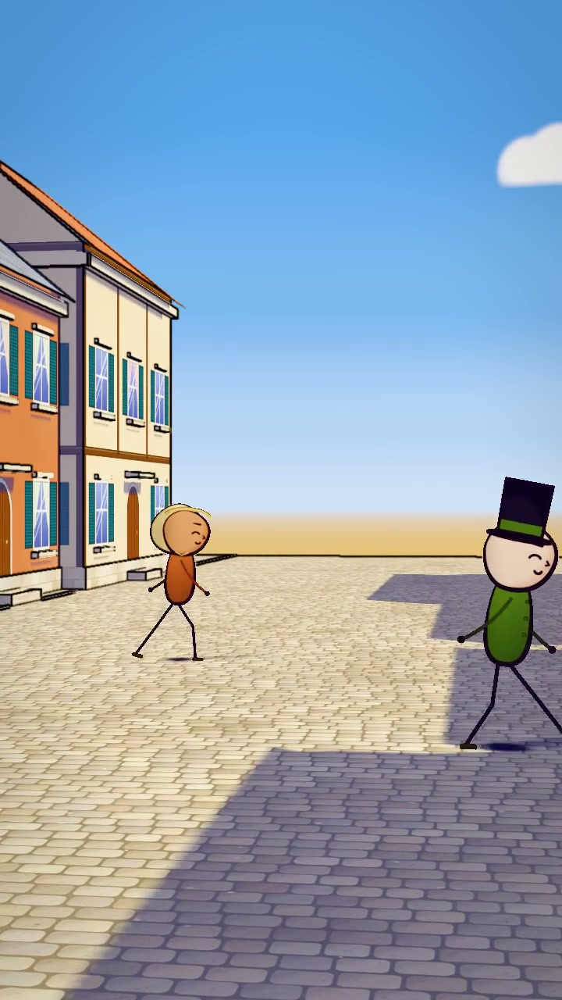

# muse-animated-shorts

**用 Muse 制作 55–70 秒病毒式卡通故事短片 —— 扁平豆头卡通角色生活在手绘 3D 世界中，使用 three.js + Remotion 本地渲染。无需视频生成 API，无需付费服务，无需订阅。**

其他语言版本：[English](README.md) · [فارسی](README.fa.md) · [Русский](README.ru.md)



*完整示例：《伦敦啤酒洪水》，1814 年 10 月 17 日，伦敦 —— 一个 7 米高的啤酒桶爆裂，淹没了一条街道。64.5 秒，720×1280，波斯语旁白。观看：[`examples/beer-flood/beer-short-final.mp4`](examples/beer-flood/beer-short-final.mp4)*

## 这是什么

这是一个给 [Muse](https://muse.ai) 的技能，把真实故事变成竖屏动画短片，风格是二维卡通角色生活在色彩鲜艳的手绘 3D 世界中：扁平豆头角色加墨水描边、饱和的天空、景深背景、滑动镜头、一位沉稳的旁白，以及进行曲风格的音乐和合成音效。

一切都在你自己的电脑上完成：

| 部分 | 方式 | 费用 |
|---|---|---|
| 画面 | three.js + Remotion 本地渲染 | $0 |
| 旁白 | Piper TTS（离线）或任何本地 TTS | $0 |
| 单词时间轴 | faster-whisper（本地，CPU） | $0 |
| 音乐 + 音效 | Python 合成（numpy/scipy） | $0 |
| 视频生成 API | 不用，也不需要 | $0 |

没有 Flow 点数，没有 Muse 视频生成，没有云渲染，没有 API 密钥，没有账号。如果某个步骤需要密钥，这个技能会告诉你本地的替代方案。

## 一句话安装

把这段话粘贴到你的 Muse 里：

> Install the muse-animated-shorts skill from https://github.com/rezabz/muse-animated-shorts: clone the repo, copy skill/muse-animated-shorts/SKILL.md to ~/.claude/skills/muse-animated-shorts/SKILL.md, then use it to make me a 55–70 second vertical cartoon story short — 2D bean-head characters in a painted 3D world, three.js inside Remotion, local TTS voice, synthesized music and SFX, no paid API. Start by asking me for the story topic.

或手动安装：

```bash
git clone https://github.com/rezabz/muse-animated-shorts.git
mkdir -p ~/.claude/skills/muse-animated-shorts
cp muse-animated-shorts/skill/muse-animated-shorts/SKILL.md ~/.claude/skills/muse-animated-shorts/SKILL.md
```

## 快速开始

```bash
# 1. 把完整示例复制为起点
cp -r muse-animated-shorts/examples/beer-flood/remotion my-short
cd my-short && npm install

# 2. 写剧本（事实 + 8 步公式）—— 见技能文档
# 3. 生成旁白（Piper）与单词时间轴（faster-whisper）
# 4. 为你的故事重写 story.ts / world.ts / 角色调度
# 5. 先渲染几秒预览，检查静帧，然后完整渲染：
npx remotion render BeerShort --image-format=jpeg --jpeg-quality=85 --scale=1.0

# 6. 合成混音（用 examples/beer-flood/audio/mix.py 生成）
ffmpeg -i silent.mp4 -i audio/mix.wav -c:v copy -c:a aac -shortest final.mp4
```

完整手册：[`skill/muse-animated-shorts/SKILL.md`](skill/muse-animated-shorts/SKILL.md)

## 短片是如何制作的

1. **主题 + 事实** —— 一个令人惊讶的真实故事，有看得见的物理因果，再加一个解释机制的日常类比。先写来源。
2. **剧本** —— 8 步：钩子 → 场景 → 升级 → 爆发 → 冷面双关 → 解释 → 后果 → 回调反转。55–70 秒，旁白从第 1 帧开始。
3. **旁白** —— 本地 TTS，本地 STT 生成单词时间轴。一切都以 `words.json` 为准。
4. **分镜计划** —— `story.ts`：镜头、运镜、交叉淡化、冲击抖动、景深。故事物理是关于时间的纯函数。
5. **世界 + 角色** —— 手绘 3D 小镇、双色调阳光、豆头卡片角色与 14 种表情库。
6. **声音** —— 原创进行曲 + 合成音效，混音音乐 +3 dB / 音效 −6 dB / 旁白不变，母带 −14 LUFS。
7. **渲染 + 质检** —— 本地渲染、合成音频、扫描黑帧/静止帧、检查响度、看画面。

## 完整示例

[`examples/beer-flood/`](examples/beer-flood/) 是《伦敦啤酒洪水》的完整制作 —— 不是演示，是真实成品：

- `remotion/` —— 完整的 Remotion 项目（`BeerShort` 合成，720×1280，30 fps，1935 帧）
- `SCRIPT.md` —— 已验证的事实 + 10 步波斯语剧本（161 词）
- `voice/` —— 波斯语旁白（`voice.wav`，64.4 秒，Piper `fa_IR-amir-medium`）+ `words.json` + 每句音频
- `audio/` —— `timeline.py`、`music.py`、`sfx.py`、`sfx_gen.py`、`instruments.py`、`dsp.py`、`mix.py`，最终混音 `mix.wav`（−14.0 LUFS，TP −1.2 dBTP）与分轨
- `beer-short-final.mp4` —— 完成的 64.5 秒短片，21 MB
- `poster.jpg` —— 海报帧

无 GPU 机器上的渲染时间：约每帧 3 秒（64 秒约 100 分钟）。有 GPU 会快得多。

## 诚实的局限

- **渲染速度。** 软件渲染很慢（720p 下约每帧 3 秒）。解决办法是 GPU 或低分辨率预览 —— 不是付费 API。
- **不是真正的视频 AI。** 角色不会像真人演员那样动；运动就是滑动、推近、行走循环和表情切换。这就是这种风格，也是它的魅力。
- **正面拍摄的平面看起来像一堵墙。** 技能文档记录了这一点以及如何避免。
- **本地 TTS 语速各不相同。** 有的声音约每秒 2.5 个词而不是 3.7 个 —— 测量你的声音，按它裁剪剧本。
- **前两帧。** 合成器的第一次推进可能渲染为空白；技能里有修复方法（复制第 2 帧），示例中已经应用。

## 结构

```
muse-animated-shorts/
├── README.md / README.fa.md / README.zh-CN.md / README.ru.md
├── LICENSE (MIT)
├── skill/muse-animated-shorts/SKILL.md   <- 操作手册
└── examples/beer-flood/                  <- 完整示例，可直接渲染
    ├── remotion/                         <- Remotion 项目
    ├── audio/                            <- 声音合成 + 混音
    ├── voice/                            <- 旁白 + 单词时间轴
    ├── SCRIPT.md
    ├── beer-short-final.mp4
    └── poster.jpg
```

## 致谢

- 风格方法改编自 [mromidev/claude-animated-shorts](https://github.com/mromidev/claude-animated-shorts)（MIT）。示例中的故事、角色、镜头、音乐和旁白完全是我们自己的。
- 使用 [Remotion](https://www.remotion.dev/)、[three.js](https://threejs.org/)、[Piper](https://github.com/rhasspy/piper)、[faster-whisper](https://github.com/SYSTRAN/faster-whisper) 制作。
- 由 [Reza BZ](https://github.com/rezabz) 用 Muse 制作。

## 许可证

MIT —— 见 [LICENSE](LICENSE)。使用它、改编它、制作你自己的短片。
