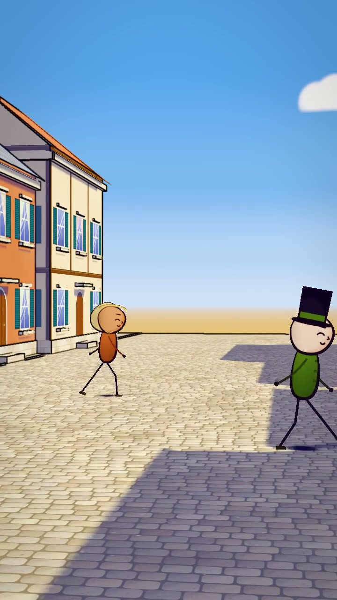

# The London Beer Flood — worked example



**"The London Beer Flood"** — London, 17 October 1814. A 22-foot (6.7 m) wooden
vat of 10-month-old porter bursts at Meux & Co's Horse Shoe Brewery, a 15-foot
wave sweeps into the St Giles rookery, eight people are killed, and Parliament
ends up refunding the tax on the spilled beer.

- **Video:** [`beer-short-final.mp4`](beer-short-final.mp4) — 64.5 s, 720×1280,
  30 fps, h264 + AAC, 21 MB. Persian narration.
- **Script:** [`SCRIPT.md`](SCRIPT.md) — verified facts + the 10-beat Persian
  script (161 words, trimmed for a ~2.5 words/s Piper voice).
- **Voice:** `voice/` — `voice.wav` (64.4 s, Piper `fa_IR-amir-medium`),
  `words.json` (word timings from faster-whisper — use the timings, not the
  spellings), and one wav per script line.
- **Sound:** `audio/` — `timeline.py`, `music.py`, `sfx.py`, `sfx_gen.py`,
  `instruments.py`, `dsp.py`, `mix.py`. Original 8-bar Bb march + 40+
  synthesized SFX cues. Final `mix.wav`: −14.0 LUFS integrated, true peak
  −1.2 dBTP, plus `stem_voice/music/sfx.wav` and `cues.md`.
- **Picture:** `remotion/` — the full Remotion project. Composition
  `BeerShort` (1935 frames). `src/videos/beer/` holds `story.ts` (shot plan),
  `world.ts` (painted 1814 London street), `cast.ts` (bean-head characters),
  plus the reusable drawing primitives (`toon.ts`, `paint.ts`, `lights.ts`,
  `shade.ts`, `cardshade.ts`, `ink.ts`, `lensblur.ts`, `grade.ts`, `build.ts`).

## Render it yourself

```bash
cd remotion
npm install
npx remotion render BeerShort --image-format=jpeg --jpeg-quality=85 --scale=1.0
# ~3 s/frame on a CPU-only machine (~100 min for the full 64 s)
ffmpeg -i silent.mp4 -i ../audio/mix.wav -c:v copy -c:a aac -shortest final.mp4
```

## Use it as a template

Copy `remotion/` to a new folder, write a new `SCRIPT.md`, record a new voice,
and rewrite `story.ts`, `world.ts` and the cast staging for your story. The
drawing primitives are reusable; the story is always new.

## Notes from the build

- Frames 0–1 of the raw render were blank (flat sky colour) — the final video
  already has frame 2 duplicated over them (see the skill's known-issues list).
- The wave reads as a wall when filmed head-on; it is shot at an angle with a
  foam roller on the crest.
- No video-generation API, no paid service and no Flow credits were used
  anywhere in this build. Everything is local.
